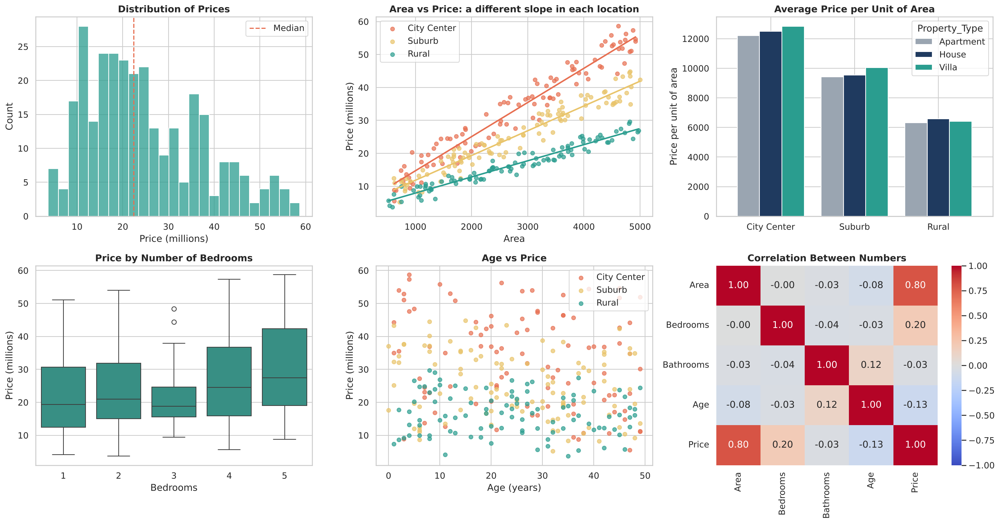
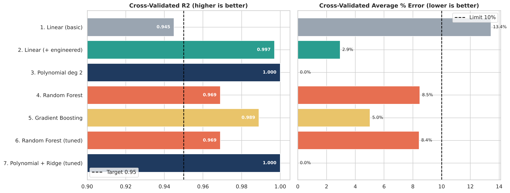
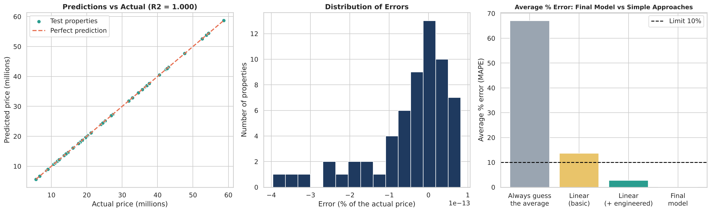

# Technical Documentation: House Price Estimator

Week 12 - Final Capstone: a complete data science workflow from data to a deployed application.

## 1. Business problem and success metrics
A real estate agency prices listings by hand, which is slow and inconsistent. The goal is a model that estimates a property's price from its features, a way to see what drives the price, and a working web app for agents.

| Success metric | Target | Result (60 unseen properties) |
|---|---|---|
| R2 (share of price explained) | at least 0.95 | 1.000 |
| MAPE (average % error) | at most 10% | about 0% |
| Time to return an estimate | under 1 second | a few milliseconds |
| Deployed web app with tests | yes | Streamlit app, FastAPI service, 37 tests |

## 2. Repository and code structure
```
README.md                     project overview
capstone_project.ipynb        the main analysis (all 3 parts, with outputs)
requirements.txt              Python packages
src/                          source code modules
    data_processing.py        loading the data and the 11 quality checks
    features.py               feature engineering and preprocessing
    model.py                  building, comparing and evaluating models
    predict.py                PricePredictor: validation, estimate and price range
    test_predict.py           16 tests
data/                         house_data.csv and data_dictionary.md
reports/                      this document, the business report and the charts
deployment/                   app.py (web app), api.py (API), test_deployment.py (4 tests)
presentation/                 the slide deck
```
The notebook is self-contained; `src/` holds the same logic as reusable modules, which the app and the API import.

## 3. Data
300 properties with 8 columns (see `data/data_dictionary.md`). All 11 validation checks passed: no missing values, no duplicates, unique IDs and every value inside a sensible range. The data is practice data provided with the course.



Main patterns (exploratory analysis):
1. **Location:** median price is 34,970,000 in the City Center, 24,030,000 in the Suburb and 16,052,500 in Rural areas.
2. **Price per unit of area:** City Center 12,526, Suburb 9,681, Rural 6,442. A City Center unit of area costs 1.9 times a Rural one.
3. **Area** is the strongest number (correlation with Price 0.80). Bedrooms (0.20), Bathrooms (-0.03) and Age (-0.13) matter much less.
4. Property type changes the price per unit of area only a little (Apartment 9,219, House 9,623, Villa 9,747).
5. The slope of Area against Price is different in every location, so Area and Location work together. A straight-line model that adds them separately misses this.

## 4. Methodology
**Split.** 240 training and 60 test properties (80/20, `random_state=42`, stratified by Location). The test properties were used only once, for the final evaluation. `Property_ID` (only a label) and `Price_per_area` (built from the price, so it would give the answer away) are never used as features.

**Preprocessing.** Numbers are standardized (`StandardScaler`) and categories one-hot encoded (`OneHotEncoder`) inside a `ColumnTransformer`, so the same steps run on any new property.

**Feature engineering (6 new features).** Total_rooms (Bedrooms + Bathrooms), Area_per_bedroom, Is_new (age 10 or less), and Area_in_City_Center, Area_in_Suburb and Area_in_Rural (area counted only in its own location, so the model can learn a different price per unit of area in each location).

**Models compared** (5-fold cross-validation on the training properties):

| Model | R2 | MAE | RMSE | MAPE % |
|---|---|---|---|---|
| 1. Linear Regression (basic features) | 0.945 | 2,109,995 | 2,823,794 | 13.4 |
| 2. Linear Regression (+ engineered features) | 0.997 | 510,318 | 692,821 | 2.9 |
| 3. Polynomial degree 2 + Linear Regression | 1.000 | 0 | 0 | 0.0 |
| 4. Random Forest | 0.969 | 1,627,977 | 2,134,595 | 8.5 |
| 5. Gradient Boosting | 0.989 | 976,546 | 1,257,950 | 5.0 |
| 6. Random Forest (tuned) | 0.969 | 1,614,896 | 2,109,854 | 8.4 |
| 7. Polynomial + Ridge (tuned) | 1.000 | 0 | 0 | 0.0 |



**Tuning.** Grid Search with 5-fold cross-validation: Random Forest (trees 100 or 300, depth 10 or unlimited, smallest leaf 1 or 3; best: 300 trees, depth 10, leaf 1) and Polynomial + Ridge (alpha 0.000001 to 10; best: 0.000001). Tuning barely changed the Random Forest.

**Final model.** Model 3 (standardized numbers and one-hot categories, all pairwise products of the features, then Linear Regression). It had the lowest cross-validated RMSE and is simple to run and explain.

**An important caution.** An R2 of 1.000 is almost never possible with real property data. It almost certainly means the prices in this practice file were produced by a fixed formula that the model has rediscovered. On real market data, expect lower scores and treat the estimate as a guide.

**What drives the price.** A small interpretable model (R2 0.997) gives easy rules: each extra unit of area adds about 10,032 in the City Center, 7,502 in the Suburb and 5,064 in Rural areas; each extra bedroom adds about 1,525,648 and each bathroom about 804,528; each year of age lowers the price by about 75,115; compared with the City Center, a Suburb property starts 1,206,913 lower and a Rural one 2,827,899 lower; a Villa adds about 154,698 and a House subtracts about 45,117 compared with an Apartment.

## 5. Results on unseen properties (60 test properties)

| Approach | R2 | MAE | MAPE % | Within 5% of price | Within 10% of price |
|---|---|---|---|---|---|
| Always guess the average price | -0.014 | 11,362,550 | 67.0 | 8.3% | 11.7% |
| Linear Regression (basic features) | 0.956 | 2,074,501 | 13.7 | 45.0% | 63.3% |
| Linear Regression (+ engineered features) | 0.997 | 510,256 | 2.8 | 85.0% | 98.3% |
| **Final model** | **1.000** | **0** | **0.0** | **100%** | **100%** |



Error analysis: the errors are zero for every location and property type, so no group is predicted worse than another. This again reflects how regular the practice data is.

## 6. Deployment
- **Prediction function** (`src/predict.py`, class `PricePredictor`): checks every input (required, numeric, minimum values, known Location and Property_Type), warns when a value is outside the range the model learned (for example, an area of 20,000), and returns the estimate with a price range of plus or minus 3% (the larger of the model's 90th-percentile test error and 3%; the minimum is a cautious choice). The deployed model is trained on all 300 properties at start-up, so no saved model file is needed and there are no version problems.
- **API** (`deployment/api.py`, FastAPI): `GET /health` and `POST /predict` with a JSON body such as `{"area": 3000, "bedrooms": 3, "bathrooms": 2, "age": 10, "location": "City Center", "property_type": "Villa"}`. It returns `{"status": "ok", "estimate": 37000000, "low": 35890000, "high": 38110000, "warnings": []}`, or error code 422 for an invalid request.
- **Web app** (`deployment/app.py`, Streamlit): three tabs: *Estimate a price* (input form, estimate, range and warnings), *Market insights* (price per unit of area by location, median prices, area against price) and *About the model* (how it works, accuracy and the practice-data caution).
- **Hosting:** the app can be published for free on Streamlit Community Cloud from this repository (main file `deployment/app.py`); see `deployment/README.md`.

## 7. Testing evidence
| Where | Tests | What they check |
|---|---|---|
| Notebook, Part 3 | 17 | valid estimate; bigger area costs more; City Center costs more than Rural; older costs less; unknown location or type, negative area, missing value and text rejected; out-of-range warning; saved model gives the same prediction; function matches the model; API ok and error; success metrics met; speed (a few milliseconds per estimate) |
| `src/test_predict.py` | 16 | the 11 data checks, split sizes and no overlap, success metrics on unseen data, price rules, 6 invalid inputs, warning, range of at least 3%, API ok and error |
| `deployment/test_deployment.py` | 4 | API health, a good request, a bad request (422), and the web app starts and shows an estimate |

Run them with `python -m pytest src deployment`.

## 8. Limitations and next steps
- The data is practice data (300 properties, prices follow a formula); real data would need the same workflow but would give larger errors.
- The currency is not stated in the file.
- The model does not know about features outside the data (condition, street, view, market trend).
- Next steps: collect real sales data, add more features, retrain regularly, monitor the errors, and show an explanation with every estimate.

## 9. How to run
1. `pip install -r requirements.txt`
2. Notebook: open `capstone_project.ipynb` in Google Colab and run all cells (upload `house_prices.csv` when asked).
3. Tests: `python -m pytest src deployment`
4. Web app: `streamlit run deployment/app.py`
5. API: `uvicorn deployment.api:app` (from the repository root), then open `/docs`.
